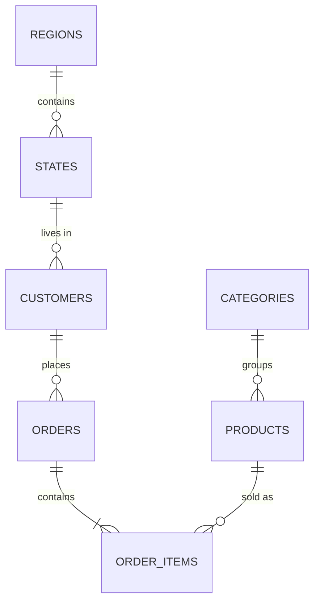

# Malaysia E-Commerce Sales Analytics: MySQL + SQL + Power BI

An end-to-end data analytics project: I designed a relational database, cleaned raw customer data with SQL, answered 10 business questions with SQL queries, and built an interactive Power BI dashboard.

> **Dataset:** simulated data for a Malaysian online retailer, covering 6,000 orders, 10,000+ order lines, 1,500 customers and 29 products across 16 states (Jan 2024 – Dec 2025). It was generated with `scripts/generate_data.py` (fixed seed, so the results are reproducible). No real customer data is used.


<!-- Replace with your real Power BI screenshots once built -->

---

## Tools
**MySQL 8** (schema design, data cleaning, analysis) · **SQL** (JOINs, CTEs, window functions) · **Power BI** (star schema, DAX, dashboard) · **Python** (data generation)

## Project structure
```
├── data/
│   ├── raw/          # raw CSVs (customers_raw has duplicates and messy values)
│   └── clean/        # cleaned star-schema tables exported for Power BI
├── sql/
│   ├── 01_schema.sql            # database + tables (3NF)
│   ├── 02_load_data.sql         # loads raw customers, categories, products
│   ├── 03_clean_customers.sql   # cleaning + de-duplication
│   ├── 03b_load_orders.sql      # loads orders and order items
│   ├── 04_analysis_queries.sql  # 10 business questions
│   └── 05_powerbi_views.sql     # star-schema views for Power BI
├── dashboard/        # Power BI .pbix file
├── images/           # dashboard screenshots
├── scripts/generate_data.py
└── POWERBI_GUIDE.md
```

## 1. Database design
Normalised to **3NF**: region and state names, and category names, live in lookup tables instead of being repeated on every row.



Constraints used: primary and foreign keys, `UNIQUE` (email), `CHECK` (price > 0, age range, discount range), `ENUM` (order status), and indexes on the join and date columns.

## 2. Data cleaning (`03_clean_customers.sql`)
The raw customer file had:

| Issue | Rows affected |
|---|---|
| Duplicate customer rows | 60 |
| Non-standard state names (`KL`, `Pulau Pinang`, `Johor Bahru`, `selangor `) | 64 |
| Blank emails | 53 (some are duplicates) |
| Extra spaces / upper-case emails | several |

Fixes: `TRIM`, `LOWER`, `NULLIF`, a `CASE` mapping to standard state names, and `ROW_NUMBER()` to keep one row per customer.
**Result: 1,560 raw rows → 1,500 clean customers**, all mapped to a valid state (validated with a `LEFT JOIN` check).

## 3. Business questions & key findings (`04_analysis_queries.sql`)

| # | Question | Finding |
|---|---|---|
| 1 | Overall performance | **RM 1.40M revenue**, 37.1% profit margin, 5,323 completed orders, AOV **RM 262** |
| 2 | Year-over-year growth | Revenue grew **+20.6%** in 2025 vs 2024 |
| 3 | Monthly trend | Peaks in **Nov–Dec** (11.11 / 12.12 sales) and around **Hari Raya** (Mar–Apr) |
| 4 | Best categories | **Electronics = 32%** of revenue; Home & Living has the best margin (38%) |
| 5 | Top products | Smartwatch is #1 (RM 152K), followed by Sneakers and Air Fryer |
| 6 | Best regions | **Selangor + KL + Johor = 47%** of revenue |
| 7 | Mega-sale impact | 11.11 / 12.12 days average **4.1× the revenue** of a normal day |
| 8 | Payment methods | **Cash on Delivery has an 18.3% cancellation rate**, about 3× other methods |
| 9 | Customer loyalty | 75% of buyers are repeat customers; the **top 10% bring 34% of revenue** |
| 10 | Age groups | Order value is similar across age groups (RM 258–264), so age isn't a strong driver |

### Recommendations
1. **Reduce COD cancellations**, for example with a small deposit or an incentive to pay by e-wallet. COD makes up 11% of orders but has the worst cancellation rate.
2. **Plan stock and marketing around 11.11, 12.12 and Raya.** These periods drive the biggest revenue spikes.
3. **Run a loyalty programme for the top 10% of customers**, who bring a third of revenue.
4. **Grow beyond the Klang Valley.** East Coast and East Malaysia states are under-represented.

## 4. Power BI dashboard
Star schema (1 fact table, 3 dimension tables including a DAX date table) with measures for revenue, profit margin, AOV, YoY growth (`SAMEPERIODLASTYEAR`), cancellation rate and repeat customers.
Pages: **Executive Overview · Customers & Payments · Products**. Full steps are in [`POWERBI_GUIDE.md`](POWERBI_GUIDE.md).

## How to run
1. Install MySQL 8 (or MariaDB) and MySQL Workbench.
2. Run the SQL files in order: `01` → `02` → `03` → `03b` → `04` → `05`.
3. Open Power BI and follow `POWERBI_GUIDE.md`.

---
**Author:** Rashid Ahmed Ali, BSc Computer Science (Data Analytics), Asia Pacific University
